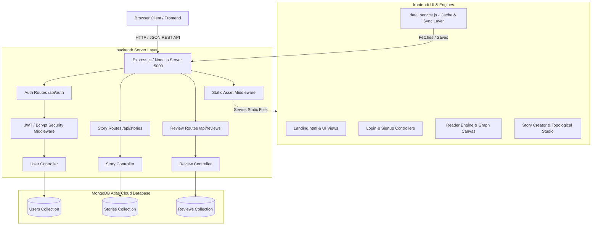

# 🌌 Dynamic Story Engine (Story Branching Universe)

> **Phase 2 Evaluation Ready:** Powered by **Node.js, Express.js, MongoDB Atlas**, and **JWT Authentication**, integrated with a reactive Neo-Brutalist frontend, Directed Graph Theory diagnostics, and procedural ambient audio.

---

## 📌 Table of Contents
1. [Project Overview & Architecture](#-system-architecture--data-model)
2. [Phase 2 Tech Stack](#-technology-stack)
3. [Project Directory Structure](#-project-structure)
4. [REST API Documentation](#-rest-api-documentation)
5. [Getting Started & Installation](#-getting-started--installation)
   - [Prerequisites](#1-prerequisites)
   - [MongoDB Atlas Setup](#2-mongodb-atlas-configuration)
   - [Running the Database Seeder](#3-database-seeding)
   - [Starting the Application](#4-running-the-application)
6. [Default Test Credentials](#-default-test-credentials)
7. [License](#-license)

---

## 🏗️ System Architecture & Data Model



### Data Schema Overview
* **User (`User.js`):** `{ id, name, email (unique), password (bcrypt hash), role ('Reader' | 'Admin'), xp, completedStories, usedFreeRetreatStories, timestamps }`
* **Story (`Story.js`):** `{ id, title, author, authorId, genre, status ('published' | 'draft'), description, imageURL, startNodeId, nodes: [ Node ], timestamps }`
* **Node (Subdocument):** `{ id, title, text, location, characters: [], isEnding, endingType ('good' | 'tragic' | 'neutral'), choices: [ Choice ] }`
* **Choice (Subdocument):** `{ id, text, targetNodeId }`
* **Review (`Review.js`):** `{ id, storyId, userId, userName, rating (1-5), comment, timestamp }`

---

## 💻 Technology Stack

### Backend (Phase 2 Integration)
* **Runtime:** Node.js (v18+)
* **Web Framework:** Express.js 4.x
* **Database:** MongoDB Atlas (Cloud) / Local MongoDB via Mongoose ORM
* **Authentication:** JSON Web Tokens (JWT) + BcryptJS Password Hashing
* **Middleware:** CORS, Morgan (HTTP Request Logging), Dotenv

### Frontend
* **Core:** HTML5 Semantic Structure, Vanilla ES6+ JavaScript (Modular OOP Classes)
* **Styling:** Vanilla CSS3 with Neo-Brutalist Design Tokens, Responsive Flexbox & Grid
* **Visuals & Canvas:** HTML5 2D Canvas API for topological graph rendering and live minimap
* **Audio & Speech:** Web Audio API (procedural synthesis) + Web Speech API (TTS narration)
* **Typography:** Google Fonts (`Bowlby One`, `Outfit`, `Plus Jakarta Sans`)

---

## 📂 Project Structure

```text
Story_Branching/
├── frontend/                         # All client-side UI, scripts & assets
│   ├── Landing.html                  # Main public landing & presentation page
│   ├── index.html                    # Root entry redirector
│   ├── db.json                       # Source database backup
│   ├── css/                          # Neo-Brutalist stylesheets
│   │   ├── style.css
│   │   ├── login.css
│   │   ├── signup.css
│   │   ├── reader.css
│   │   ├── admin.css
│   │   └── stories.css
│   ├── js/                           # Frontend controllers & engine classes
│   │   ├── data_service.js           # REST API client with local fallback
│   │   ├── login.js                  # JWT login controller
│   │   ├── signup.js                 # Registration controller
│   │   ├── reader.js                 # Interactive branching reader & sessions
│   │   ├── stories.js                # Story authoring & node graph controller
│   │   ├── admin.js                  # Admin management studio
│   │   ├── graph_studio.js           # Graph topology diagnostics & canvas
│   │   ├── ai_engine.js              # Lexical sentiment & story recommendations
│   │   └── audio_engine.js           # Procedural Web Audio synthesizer
│   └── pages/
│       ├── auth/                     # login.html, signup.html
│       ├── admin/                    # admin.html, add_stories.html
│       └── reader/                   # stories.html, play.html
│
├── backend/                          # Express.js, Node.js & MongoDB Atlas Layer
│   ├── package.json                  # Backend dependencies & npm scripts
│   ├── server.js                     # Express server & static asset host
│   ├── .env.example                  # Environment configuration template
│   ├── config/
│   │   └── db.js                     # MongoDB connection with Mongoose
│   ├── models/
│   │   ├── User.js                   # Mongoose User model with bcrypt hooks
│   │   ├── Story.js                  # Mongoose Story & Node Graph model
│   │   └── Review.js                 # Mongoose Review & Ratings model
│   ├── controllers/
│   │   ├── authController.js         # Register, Login, Profile & XP tracking
│   │   ├── storyController.js        # Story CRUD & Graph persistence
│   │   └── reviewController.js       # Reviews & average ratings calculations
│   ├── routes/
│   │   ├── authRoutes.js             # /api/auth endpoints
│   │   ├── storyRoutes.js            # /api/stories endpoints
│   │   └── reviewRoutes.js           # /api/reviews endpoints
│   ├── middleware/
│   │   └── authMiddleware.js         # JWT verification & RBAC authorization
│   └── scripts/
│       └── seed.js                   # Automated database migration into MongoDB
│
├── package.json                      # Root workspace scripts (dev, start, seed)
├── vercel.json                       # Deployment rewrites
├── .gitignore
└── README.md                         # Comprehensive documentation
```

---

## 📡 REST API Documentation

### 1. Authentication (`/api/auth`)
| Method | Endpoint | Description | Access |
| :--- | :--- | :--- | :--- |
| `POST` | `/api/auth/register` | Register new user, hashes password, returns JWT token | Public |
| `POST` | `/api/auth/login` | Authenticate user credentials, returns JWT token | Public |
| `GET` | `/api/auth/me` | Fetch currently authenticated user profile | Private (JWT) |
| `PUT` | `/api/auth/progress` | Sync reader XP, completed stories, and time-warps | Authenticated |

### 2. Stories & Narrative Graph (`/api/stories`)
| Method | Endpoint | Description | Access |
| :--- | :--- | :--- | :--- |
| `GET` | `/api/stories` | Retrieve stories (supports `?genre=`, `?search=`, `?status=`) | Public |
| `GET` | `/api/stories/:id` | Fetch full story details and complete node graph | Public |
| `POST` | `/api/stories` | Create a new branching story universe | Private/Admin |
| `PUT` | `/api/stories/:id` | Update story metadata, nodes, and choice connections | Private/Admin |
| `DELETE` | `/api/stories/:id` | Delete story and associated community reviews | Private/Admin |

### 3. Reviews & Ratings (`/api/reviews`)
| Method | Endpoint | Description | Access |
| :--- | :--- | :--- | :--- |
| `GET` | `/api/reviews` | Get all reviews or filter by story (`?storyId=...`) | Public |
| `POST` | `/api/reviews` | Post a reader review & 1-5 star rating | Public/Reader |

### 4. Health Check
| Method | Endpoint | Description |
| :--- | :--- | :--- |
| `GET` | `/api/health` | Server uptime & MongoDB connection status |

---

## 🚀 Getting Started & Installation

### 1. Prerequisites
- **Node.js** (v18.x or v20.x recommended)
- **MongoDB Atlas account** (or local MongoDB community server)
- Modern web browser (Chrome, Edge, Firefox, Safari)

### 2. MongoDB Atlas Configuration
1. Open [`backend/.env`](backend/.env).
2. Set your `MONGO_URI` to your MongoDB Atlas connection string:
   ```env
   MONGO_URI=mongodb+srv://<username>:<password>@cluster0.mongodb.net/story_branching?retryWrites=true&w=majority
   PORT=5000
   JWT_SECRET=story_branching_jwt_secret_token_key_2026
   JWT_EXPIRE=7d
   ```
   *(If you run MongoDB locally, you can use `mongodb://127.0.0.1:27017/story_branching`)*

### 3. Database Seeding
To populate MongoDB with existing stories, users, and community reviews:
```bash
npm run seed
```
This script reads `frontend/db.json`, hashes all passwords securely with `bcrypt`, and imports all story graph topologies into MongoDB Atlas.

### 4. Running the Application
From the root directory:

**Development Mode (with auto-reload):**
```bash
npm run dev
```

**Production Mode:**
```bash
npm start
```

Open your browser at:
👉 **`http://localhost:5000`**

The Express backend serves the integrated frontend directly. You can also open the API health check at **`http://localhost:5000/api/health`**.

---

## 🔑 Default Test Credentials

| Role | Email | Password | Starting XP |
| :--- | :--- | :--- | :--- |
| **Admin** | `admin@gmail.com` | `admin123` | 999 XP |
| **Reader** | `testreader@example.com` | `password123` | 150 XP |
| **Student** | `aniket3113.beai24@chitkara.edu.in` | `1234` | 100 XP |

---

## 📜 License
This project is open-source and licensed under the **MIT License**.
