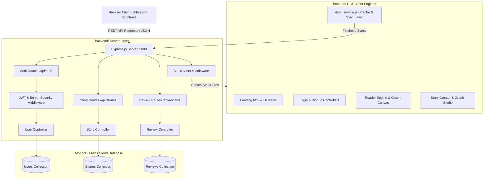

# 🌌 Dynamic Story Engine (Story Branching Universe)

[](https://nodejs.org/)
[](https://expressjs.com/)
[](https://www.mongodb.com/atlas)
[](https://jwt.io/)
[](LICENSE)

> **Phase 2 Evaluation Edition:** An AI-powered interactive branching narrative universe built on **Directed Graph Theory (DAGs)**, procedural Web Audio soundscapes, lexical sentiment analysis, and a modern fullstack architecture powered by **Express.js, Node.js, and MongoDB Atlas**.

---

## 📌 Table of Contents
1. [🎯 Project Aim & Key Objectives](#-project-aim--key-objectives)
2. [⚡ Phase 1 vs. Phase 2 Architecture](#-phase-1-vs-phase-2-evolution)
3. [✨ Core Features & Scientific Highlights](#-core-features--scientific-highlights)
4. [🏗️ System Architecture & Data Model](#️-system-architecture--data-model)
5. [💻 Technology Stack](#-technology-stack)
6. [📂 Project Directory Structure](#-project-directory-structure)
7. [📡 REST API Reference](#-rest-api-reference)
8. [🚀 Getting Started & Installation](#-getting-started--installation)
   - [Prerequisites](#1-prerequisites)
   - [MongoDB Atlas Configuration](#2-mongodb-atlas-configuration)
   - [Database Seeding](#3-database-seeding)
   - [Running the Application](#4-running-the-application)
9. [🔑 Default Test Credentials](#-default-test-credentials)
10. [🔮 Future Roadmap](#-future-roadmap)
11. [📜 License](#-license)

---

## 🎯 Project Aim & Key Objectives

Traditional interactive storytelling suffers from disconnected narrative dead-ends, circular logic flaws, and static presentations. The **Dynamic Story Engine** bridges creative narrative prose with **discrete mathematics (Directed Graph Theory)**, **real-time Natural Language Processing (NLP)**, and **procedural Web Audio/Speech synthesis**.

### Key Objectives:
* **Mathematical Narrative Modeling:** Formulate interactive fiction as directed graphs $G = (V, E)$, where vertices $V$ represent story scenes/nodes and directed edges $E$ represent player decisions.
* **Topological Health Diagnostics:** Implement graph algorithms (Depth-First Search loop/cycle detection, unreachable orphan node detection, in-degree/out-degree audits, narrative entropy) to mathematically guarantee story integrity.
* **Lexical Sentiment Atmosphere Synchronization:** Dynamically parse scene narrative to extract emotional vectors (Thrill, Suspense, Heroism, Melancholy, Peace, Danger) and adjust visual glows and ambient procedural soundscapes in real time.
* **Enterprise Persistence & Security:** Transition from mock data to a resilient **MongoDB Atlas cloud database** with **JSON Web Tokens (JWT)** and **Bcrypt** cryptographic password hashing.

---

## ⚡ Phase 1 vs. Phase 2 Evolution

| Architectural Dimension | Phase 1 (Prototype) | Phase 2 (Production Fullstack) |
| :--- | :--- | :--- |
| **Backend Framework** | `json-server` (Mock REST API) | **Express.js 4.x + Node.js** |
| **Database** | Static local `db.json` file | **MongoDB Atlas Cloud Database (Mongoose ORM)** |
| **Authentication** | Plaintext password comparison | **JSON Web Tokens (JWT) + Bcrypt Hashing (Salt 10)** |
| **Folder Architecture** | Nested prototype folders | Clean **`frontend/`** and **`backend/`** modular split |
| **Client-Server Flow** | Hardcoded port coupling | **Integrated Express Static Host + CORS REST API** |
| **Data Resiliency** | LocalStorage only | **MongoDB Atlas Cloud Persistence + Resilient Client Cache** |

---

## ✨ Core Features & Scientific Highlights

### 1. Immersive Interactive Reader Engine
* **Graph Traversal:** Real-time navigation through narrative graphs with multiple ending classifications (*Good, Neutral, Tragic, Catastrophic*).
* **Live Minimap Canvas:** Interactive 2D canvas overlay mapping the entire topology and tracking the reader's real-time journey.
* **Time-Warp Retreat Mechanic:** XP-cost decision backtracking that allows readers to undo fatal choices without restarting the story.
* **Multi-Slot Save System:** Save and load checkpoints across multiple named progress slots.
* **Journey Chronicle Exporter:** Generates formatted transcripts of the reader's unique decision path for download as JSON or text.

### 2. Graph Studio & Topological Diagnostics
* **Dual-View Authoring:** Switch between structured scene cards and an interactive visual node-link canvas graph.
* **Mathematical Validator:**
  * **DFS Cycle Detection:** Detects circular loops to maintain Directed Acyclic Graph (DAG) compliance.
  * **Orphan Node Audit:** Identifies unreachable scenes with zero in-degree edges.
  * **Terminal Dead-End Audit:** Flags non-ending scenes lacking choice edges.
  * **Branching Entropy:** Measures narrative complexity and decision diversity.

### 3. AI / NLP & Procedural Audio Engine
* **Lexical Sentiment Parsing:** Analyzes scene emotional tone in real time to shift page glow gradients.
* **Procedural Synthesizer (Web Audio API):** Generates real-time ambient soundscapes (*Cyberpunk Drone, Mystery Harmonics, Tension Pulse, Ethereal Peace, Victory Chords*) using multi-oscillator synthesis and biquad filters without external audio files.
* **AI Voice Narration (Web Speech API):** Built-in Text-To-Speech (TTS) narrator with cadence control and automatic pause upon scene transition.

### 4. Community Reviews & Gamification
* **Live Community Reviews:** 5-star ratings and reader reviews synchronized to MongoDB Atlas.
* **Reader Progression:** Tracks reader XP, achievements, level badges, and completed stories.

---

## 🏗️ System Architecture & Data Model



### Data Schema Overview

* **`User` Schema:**
  ```javascript
  {
    name: String,
    email: { type: String, unique: true },
    password: { type: String, select: false }, // Bcrypt hash
    role: { type: String, enum: ['Reader', 'Admin'], default: 'Reader' },
    xp: { type: Number, default: 100 },
    completedStories: [String],
    usedFreeRetreatStories: [String],
    timestamps: true
  }
  ```
* **`Story` Schema:**
  ```javascript
  {
    id: { type: String, unique: true },
    title: String,
    author: String,
    authorId: String,
    genre: String,
    status: { type: String, enum: ['published', 'draft'] },
    description: String,
    imageURL: String,
    startNodeId: String,
    nodes: [{
      id: String,
      title: String,
      text: String,
      location: String,
      characters: [String],
      isEnding: Boolean,
      endingType: String,
      choices: [{ id: String, text: String, targetNodeId: String }]
    }]
  }
  ```
* **`Review` Schema:**
  ```javascript
  {
    id: String,
    storyId: { type: String, index: true },
    userId: String,
    userName: String,
    rating: { type: Number, min: 1, max: 5 },
    comment: String,
    timestamp: String
  }
  ```

---

## 💻 Technology Stack

* **Backend Runtime:** Node.js (v18+)
* **Web Framework:** Express.js 4.x
* **Database & ODM:** MongoDB Atlas Cloud + Mongoose 8.x
* **Security & Auth:** JSON Web Tokens (`jsonwebtoken`), `bcryptjs`
* **Frontend Core:** HTML5 Semantic Structure, Vanilla ES6+ OOP Classes
* **Design & Styling:** Custom CSS3 with Neo-Brutalist Design Tokens & Glassmorphism
* **Visuals & Graphics:** HTML5 2D Canvas API for topological graph rendering
* **Audio & Speech:** Web Audio API (procedural oscillator soundscapes) + Web Speech API (TTS)
* **Typography:** Google Fonts (`Bowlby One`, `Outfit`, `Plus Jakarta Sans`)

---

## 📂 Project Directory Structure

```text
Story_Branching/
├── frontend/                         # Client-side UI views, engines & assets
│   ├── Landing.html                  # Public marketing & feature showcase page
│   ├── index.html                    # Root entry redirector
│   ├── db.json                       # Backup seed data
│   ├── css/                          # Neo-Brutalist stylesheets
│   │   ├── style.css                 # Global design system & tokens
│   │   ├── login.css                 # Auth styles
│   │   ├── signup.css                # Register styles
│   │   ├── reader.css                # Interactive player & library styles
│   │   ├── admin.css                 # Admin analytics styles
│   │   └── stories.css               # Graph Studio styles
│   ├── js/                           # Modular client engines
│   │   ├── data_service.js           # REST API client with local fallback
│   │   ├── login.js                  # JWT login controller
│   │   ├── signup.js                 # Registration controller
│   │   ├── reader.js                 # Reader engine & session manager
│   │   ├── stories.js                # Story editor controller
│   │   ├── admin.js                  # Admin studio controller
│   │   ├── graph_studio.js           # Graph canvas renderer & DAG diagnostics
│   │   ├── ai_engine.js              # Lexical sentiment analysis & NLP suggestions
│   │   └── audio_engine.js           # Procedural Web Audio synthesizer
│   └── pages/                        # Application views
│       ├── auth/                     # login.html, signup.html
│       ├── admin/                    # admin.html, add_stories.html
│       └── reader/                   # stories.html, play.html
│
├── backend/                          # Express.js, Node.js & MongoDB Atlas Server
│   ├── package.json                  # Server dependencies & scripts
│   ├── server.js                     # Express app, static host & route registration
│   ├── .env.example                  # Environment template
│   ├── .env                          # Local credentials (ignored by git)
│   ├── config/
│   │   └── db.js                     # MongoDB Mongoose connection handler
│   ├── models/
│   │   ├── User.js                   # User Mongoose model with bcrypt pre-save
│   │   ├── Story.js                  # Story & node graph Mongoose model
│   │   └── Review.js                 # Review & rating Mongoose model
│   ├── controllers/
│   │   ├── authController.js         # Register, login, profile, XP sync
│   │   ├── storyController.js        # Story CRUD & branching persistence
│   │   └── reviewController.js       # Review posting & rating aggregations
│   ├── routes/
│   │   ├── authRoutes.js             # /api/auth router
│   │   ├── storyRoutes.js            # /api/stories router
│   │   └── reviewRoutes.js           # /api/reviews router
│   ├── middleware/
│   │   └── authMiddleware.js         # JWT verify & RBAC middleware
│   └── scripts/
│       └── seed.js                   # Automated Atlas cloud database seeder
│
├── package.json                      # Root orchestration scripts
├── vercel.json                       # Deployment rewrites
├── .gitignore                        # Protects node_modules & .env
└── README.md                         # Comprehensive documentation
```

---

## 📡 REST API Reference

### 1. Authentication Endpoints (`/api/auth`)
| Method | Endpoint | Description | Access |
| :--- | :--- | :--- | :--- |
| `POST` | `/api/auth/register` | Register new user, hashes password, returns JWT token | Public |
| `POST` | `/api/auth/login` | Validate credentials, returns JWT token + user profile | Public |
| `GET` | `/api/auth/me` | Fetch authenticated user profile and XP | Private (Bearer JWT) |
| `PUT` | `/api/auth/progress` | Sync reader XP, completed stories, and retreat states | Authenticated |

### 2. Stories & Narrative Graph Endpoints (`/api/stories`)
| Method | Endpoint | Description | Access |
| :--- | :--- | :--- | :--- |
| `GET` | `/api/stories` | Retrieve stories (filter by `?genre=`, `?search=`, `?status=`) | Public |
| `GET` | `/api/stories/:id` | Fetch full story details, scene nodes, and choice graph | Public |
| `POST` | `/api/stories` | Create a new branching story universe | Private/Admin |
| `PUT` | `/api/stories/:id` | Update story graph, scenes, and node connections | Private/Admin |
| `DELETE` | `/api/stories/:id` | Delete story and associated community reviews | Private/Admin |

### 3. Reviews & Ratings Endpoints (`/api/reviews`)
| Method | Endpoint | Description | Access |
| :--- | :--- | :--- | :--- |
| `GET` | `/api/reviews` | Get all reviews or filter by story (`?storyId=...`) | Public |
| `POST` | `/api/reviews` | Submit a reader review & 1–5 star rating | Public/Reader |

### 4. System Health Check
| Method | Endpoint | Description |
| :--- | :--- | :--- |
| `GET` | `/api/health` | Live server status and MongoDB Atlas connection state |

---

## 🚀 Getting Started & Installation

### 1. Prerequisites
* [Node.js](https://nodejs.org/) (v18.x or v20.x recommended)
* A [MongoDB Atlas](https://www.mongodb.com/atlas) account (or local MongoDB server)
* Modern web browser (Chrome, Edge, Firefox, Safari)

### 2. Clone and Install Dependencies
From the repository root:
```bash
# Install backend dependencies
cd backend
npm install
cd ..
```

### 3. MongoDB Atlas Configuration
Create a `.env` file in the `backend/` directory:
```bash
# In backend/.env
PORT=5000
NODE_ENV=development
MONGO_URI=mongodb+srv://<username>:<password>@cluster0.xxxxx.mongodb.net/story_branching?retryWrites=true&w=majority
JWT_SECRET=story_branching_jwt_secret_token_key_2026
JWT_EXPIRE=7d
```

### 4. Database Seeding
To automatically populate your MongoDB Atlas cluster with users, sample branching stories, and community reviews:
```bash
npm run seed
```

### 5. Running the Application
From the root directory:

**Development Mode (auto-reload with nodemon):**
```bash
npm run dev
```

**Production Mode:**
```bash
npm start
```

Open your browser at:
👉 **`http://localhost:5000`**

* Check API Health: `http://localhost:5000/api/health`
* Admin Studio: `http://localhost:5000/pages/admin/admin.html`
* Reader Universe: `http://localhost:5000/pages/reader/stories.html`

---

## 🔑 Default Test Credentials

| Role | Email | Password | Initial XP | Permissions |
| :--- | :--- | :--- | :--- | :--- |
| **Admin** | `admin@gmail.com` | `admin123` | 999 XP | Story Authoring, Graph Studio, Deletion, Full Access |
| **Reader** | `testreader@example.com` | `password123` | 150 XP | Story Exploration, Save Checkpoints, Community Reviews |
| **Student** | `aniket3113.beai24@chitkara.edu.in` | `1234` | 100 XP | Reader Profile, Choice Traversal, Progress Sync |

---

## 🔮 Future Roadmap

- [ ] **Multiplayer Cooperative Branching:** Enable multiple readers to vote on choices in real time via WebSockets.
- [ ] **Direct LLM Narrative Expansion:** Connect Gemini / OpenAI API endpoints for live procedural branch generation.
- [ ] **Rich Media Nodes:** Support inline scene video, 3D Canvas scenes (Three.js), and custom audio tracks per node.
- [ ] **Standard Format Import/Export:** Support standard Twine (`.twee`) and Ink format importing and exporting.

---

## 📜 License

This project is open-source and available under the **[MIT License](LICENSE)**.
